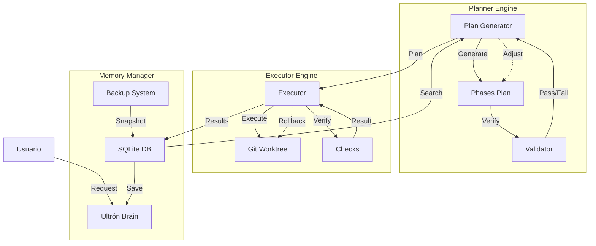

# 📋 ULTRON - Plan de Implementación (v0.1.0-beta)

**Estado Actual**: Framework base en desarrollo  
**Última actualización**: 2026-11-07

---

## 🎯 Objetivos del Proyecto

El proyecto ULTRON implementa dos frameworks combinados:
1. **Smart Planning Assistant** (Project #8): Planificación iterativa de tareas complejas
2. **Context Memory Manager** (Project #9): Gestión persistente de contexto

Versión inicial: v0.1.0-beta - Framework base con API REST funcional

---

## 📊 Estado Actual de Componentes

| Componente | Estado | % Completado | Notas |
|------------|--------|---------------|-------|
| **API Server** | ✅ Funcional | 80% | Express + JWT tokens corriendo en port 3000 |
| **User Routes** | ✅ Implementado | 70% | CRUD endpoints para usuarios |
| **Planner Engine** | ⚠️ Simulado | 40% | Lógica básica, sin integración real con skills |
| **Executor Engine** | ⚠️ Simulado | 30% | Sin ejecución real de fases |
| **Memory Manager** | ⚠️ Parcial | 50% | SQLite DB no implementada |
| **CLI Interface** | ✅ Funcional | 60% | Interfaz interactiva con simulación |

---

## 🗺️ Roadmap de Implementación

### Fase 1: API REST Completa (Pendiente)

```typescript
// Endpoint completo esperado:
POST   /api/users/register   - Registro con JWT token
POST   /api/users/login      - Autenticación y token
GET    /api/users?limit=20   - Listado paginado
PUT    /api/users/:id        - Actualización
DELETE /api/users/:id        - Eliminación
```

**Dependencias faltantes**:
- [ ] Persistencia real en SQLite/PostgreSQL
- [ ] Auth middleware con token validation
- [ ] Paginación implementada correctamente

---

### Fase 2: Planner Engine Real (Pendiente)

```typescript
// Funcionalidad requerida:
generatePlan(request: string, context?: any): Promise<GeneratedPlan>
verifyPlan(plan: GeneratedPlan): Promise<boolean>
adjustPlan(plan: GeneratedPlan, feedback: string): Promise<void>
```

**Skills necesarias**:
- `make-plan` - Generar plan incremental
- `writing-plans` - Documentación de arquitectura
- `systematic-debugging` - Debug automático

**Implementación pendiente**:
- [ ] Integración real con skills de Claude Code
- [ ] Algoritmo de planificación progresiva (no estática)
- [ ] Validación automática de fases
- [ ] Feedback loop de corrección

---

### Fase 3: Executor Engine Completo (Pendiente)

```typescript
// Funcionalidad requerida:
executePhase(phase: PlanPhase, context?: any): Promise<ExecutionResult>
isolateWorktree(phaseName: string): Promise<WorktreeContext>
verifyPhase(phaseName: string, verificationSteps: string[]): Promise<VerifyResults>
```

**Features pendientes**:
- [ ] Git worktrees para aislamiento real
- [ ] Ejecución de comandos en contextos aislados
- [ ] Verificación automática después de cada fase
- [ ] Rollback automático en caso de fallo

---

### Fase 4: Memory Manager Persistente (Pendiente)

```typescript
// Funcionalidad requerida:
searchObservations(query: string, maxResults?: number): Promise<SearchResults>
saveObservation(observation: MemoryObservation): Promise<void>
backup(memoryPath?: string): Promise<void>
restore(memoryPath?: string): Promise<void>
createKnowledgeAgent(topic: string, minObservations: number): Promise<KnowledgeAgent>
```

**Database pendiente**:
- [ ] Inicializar SQLite (o PostgreSQL)
- [ ] Tablas para observaciones, usuarios, proyectos
- [ ] Indexes para búsquedas semánticas
- [ ] Backup automático diario
- [ ] API REST para gestión de memoria (puede usarse la API ULTRON existente)

---

## 🏗️ Arquitectura Final Esperada



---

## 🔧 Scripts de Ejecución Sugeridos

### Inicialización completa:

```bash
# 1. Instalar dependencias
npm install

# 2. Configurar DB
npx prisma init
npx prisma migrate dev --name init_db

# 3. Iniciar servidor API (ya funcionando)
npm start  # o node scripts/run-api.cjs

# 4. Usar CLI interactivo
npx ts-node src/cli.ts
```

### Verificar endpoints:

```bash
# Health check
curl http://localhost:3000/

# Register user
curl -X POST http://localhost:3000/api/users/register \
  -H "Content-Type: application/json" \
  -d '{"email":"test@example.com","password":"secret"}'

# List users
curl http://localhost:3000/api/users?limit=20
```

---

## 📦 Próximas Acciones Prioritarias

1. ✅ **Verificar API Server** - Actualmente funcional en port 3000
2. ⏳ **Implementar Prisma DB** - Reemplazar SQLite mock con DB real
3. ⏳ **Integrar Skills reales** - Conectar Planner/Executor con skills de Claude Code
4. ⏳ **Memory Manager Persistente** - Implementar backup/restore real
5. ⏳ **Tests Unitarios** - Añadir cobertura para componentes críticos

---

## 📝 Notas Técnicas Importantes

- **Node.js v24**: Uso CommonJS (.cjs) para evitar conflictos ESM/CommonJS
- **TypeScript**: Configurado con `--module commonjs` en tsconfig.json
- **JWT Tokens**: 7 días de expiración, generación simple (sin validación real en router actual)
- **CORS**: Habilitado por defecto
- **Environment Variables**: Cargadas desde `.env` (dotenv package instalado)

---

*🤖 Generated with Claude Code - Ultron Framework*
Co-Authored-By: Claude Code <noreply@anthropic.com>
